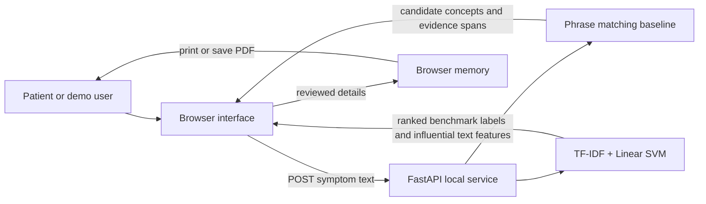

# Prototype architecture

## Context



The browser submits text to the local API for phrase extraction and, only when requested, model ranking. The API has no database and does not persist request content. Reviewed notes and summary rendering stay in the current browser tab. Refreshing or closing the page clears the draft.

## Components

- **Browser UI:** captures a free-text note, duration and self-reported severity; shows candidate symptom concepts for correction; renders a printable summary.
- **FastAPI API:** validates request size and passes text to the extraction module. It has no user accounts, record storage, or clinician view.
- **Phrase-matching baseline:** maps a small transparent phrase list to canonical concepts, returns the matched text and offsets, and applies limited nearby-negation handling.
- **Closed-label model:** TF-IDF n-grams plus a Linear SVM trained on the included dataset's training split. It returns three class labels and input tokens contributing to each ranking. These are dataset-relative text model outputs, not clinical evidence, diagnoses or probabilities.
- **Offline evaluator:** compares extracted canonical concepts with an approved annotated JSONL reference set. It reports micro precision, recall and F1.

## Current data flow

1. The user enters a note in the browser.
2. The browser sends the note to `POST /api/extract` to get candidate concepts and exact text spans.
3. On request, the browser sends the same note to `POST /api/rank` for three ranked labels from the benchmark model.
4. The user reviews, removes or adds summary details in browser memory.
5. The browser creates a pre-visit summary locally and opens the print dialog.

## API contract

### `GET /api/health`

Returns service mode and status.

### `POST /api/extract`

Request:

```json
{"text":"I have had a headache since yesterday and feel tired"}
```

Response:

```json
{
  "matches": [
    {"concept":"headache","mention":"headache","start":15,"end":23,"status":"candidate","method":"phrase_match_baseline"},
    {"concept":"fatigue","mention":"feel tired","start":39,"end":49,"status":"candidate","method":"phrase_match_baseline"}
  ],
  "notice":"These phrase matches are candidates for review, not a diagnosis or medical advice."
}
```

The illustrative offsets above depend on the exact request text. The service rejects empty or oversized requests. Summary data is not sent back to the API.

### `POST /api/rank`

Request:

```json
{"text":"I've had a headache and feel tired"}
```

Response includes up to three ordered benchmark labels and model-contributing text features. It intentionally includes no percentage or probability. Every response carries a notice that the output is not a diagnosis or medical advice.

## Next architecture gates

- The current target is closed-set classification on the supplied benchmark; do not interpret its output as patient-specific clinical likelihood.
- Reassess the task and dataset with the supervisor before any clinical or local-population claim.
- Add storage, authentication, clinician access or data export only after a privacy threat model and approved requirements exist.
- Treat any trained model as a separate replaceable extractor interface and evaluate on a held-out set with leakage controls.
- Do not add diagnosis ranking or urgency advice without clinical oversight, suitable evidence and a defined validation plan.
